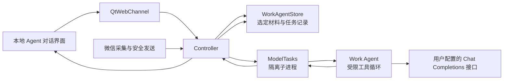

# 知弦 PC 源码与 Work Agent 架构（本地开发版）

本文件按实际代码的职责划分知弦，帮助在增加功能时守住数据边界。当前本地开发内容尚未推送到公开 GitHub 仓库。

## 模块与数据流

| 层 | 主要文件 | 职责 |
| --- | --- | --- |
| 桌面壳 | `src/main.py` | 启动 PySide6、WebEngine、托盘与本地界面；WebEngine 不保存浏览器 Cookie 或磁盘缓存。 |
| 界面 | `ui/app.js`、`ui/experience.js`、`ui/experience.css` | 导航、对话工作台、Work Agent、会话巡检、自动回复、朋友圈和设置；通过 QtWebChannel 发起 RPC。 |
| 桥接 | `src/desk/bridge.py` | 检查 JSON 请求大小，转交控制器，异步返回结果；模型密钥不随状态快照传给界面。 |
| 控制器 | `src/desk/controller.py` | 校验操作和范围，协调数据源、模型进程及本机文件；自动回复策略始终在此独立执行。 |
| 本机数据 | `src/desk/store.py`、`work_agent_store.py`、`imports.py` | DPAPI 密钥配置、知识笔记、ChatLab 索引；Work Agent 的任务、用户选定材料与成果保存在专属本机目录。 |
| 聊天来源 | `src/desk/datahub.py`、`wechat_db_source.py`、`wechat_sqlcipher.py`、`cipher_config.py`、`weflow.py` | 分页读取已连接的 WeFlow、用户导入内容、本机微信加密数据库或采集到的会话。 |
| 模型核心 | `src/core/client.py`、`engine.py`、`questions.py`、`draft.py`、`backlog.py`、`moments.py`、`media.py` | Jev 结构化判断、候选回复、回复时机、朋友圈建议与按需媒体处理。 |
| Agent | `src/core/agent.py`、`work_agent.py` | 前者是旧会话巡检；后者是独立的多轮 Work Agent，拥有受限的材料检索、读取和成果生成工具。 |
| 任务隔离 | `src/desk/tasks.py` | 将联网模型调用放进可终止的子进程；普通 Qt 界面线程不执行长时请求。 |
| Windows 操作 | `src/desk/capture_service.py`、`src/app/` | 微信窗口采集、OCR、经目标和输入框核验的回填或自动发送。Work Agent 没有调用发送能力。 |

## Work Agent 的一次工作回合

1. 用户在 Agent 页创建任务，输入目标并通过本机文件选择器加入材料。浏览器界面只收到附件 ID、名称和类型，不接收原文件路径或密钥。
2. `WorkAgentStore` 将选定文件复制到本机私有任务目录。文本、PDF、Office 文件提取为有限长文字；图片经 Pillow 限尺寸、重新编码并去除 EXIF。扫描版 PDF 暂无可提取文字时会明确报错。
3. 控制器取该任务最近的对话和已经加入的材料，加入待处理的用户消息，仅把 Work 模型所需的配置与内容传给隔离子进程。数据会发送到用户配置的模型服务；没有自动读取微信全库或任意磁盘目录。
4. `work_agent.py` 使用 OpenAI 兼容 Chat Completions。模型可请求 `list_materials`、`search_materials`、`read_material`、`write_artifact`，但每个工具只接受本任务的材料 ID 或受限的成果名称。总轮次、调用次数、上下文和文件大小都有上限；服务不支持工具协议时，仍可用已检索片段直接回答。
5. 生成成果先作为内存中的文字提案返回控制器，由 `WorkAgentStore` 再次验证文件名、格式与大小后写入任务成果目录。用户可在应用内用纯文本预览，点击“保存文件”才选择导出位置。

运行时会报告读取、模型处理和保存阶段。用户停止任务时，控制器终止对应的隔离模型进程，并在提交任务历史和成果前再次检查取消状态；迟到的模型结果不会落盘。每一轮模型请求都重新核算上下文长度，防止多次工具调用突破预算。

Work Agent 不运行终端命令、不浏览任意网页、不代替用户发送微信或朋友圈内容。旧 `run_agent` 继续作为“会话巡检”次级入口；自动回复仍走独立白名单和发送核验，不继承 Work Agent 的材料或工具权限。

## 数据与发布边界

Work Agent 的任务、原始选定材料副本及成果位于 `data/work-agent/`，属于本机明文私有数据，不进入源码仓库或发行包。提取文字在处理时进入内存中的有界材料上下文。API Key 保存在现有 DPAPI 凭据文件中；Work 模型若与 Jev 服务同源，可按配置复用主 Key，跨来源不会自动转发。删除任务会删除该任务的本机目录，导出到其他位置的成果不受影响。

公开 GitHub 仓库当前已有旧版核心源码及历史提交。忽略规则和密钥扫描用于防止今后的误提交，不能撤回既有公开提交。Work Agent 的本地开发源码在公开边界确定前不推送。
